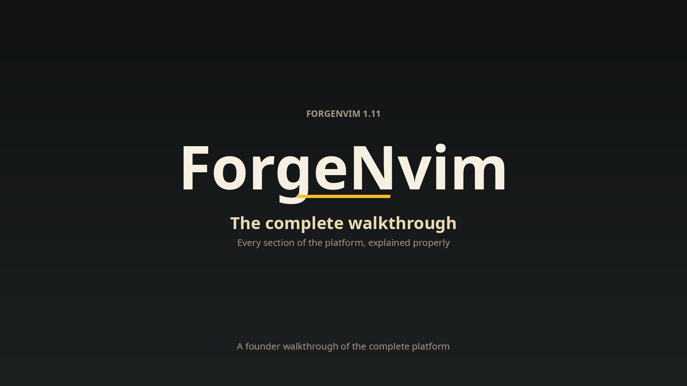

# ForgeNvim

**A complete coding environment in one window: your files, your editor, and a team of AI coding agents, side by side.**


## Watch the walkthrough

[](assets/ForgeNvim-Walkthrough.mp4)

▶ **[Watch the full platform tour](assets/ForgeNvim-Walkthrough.mp4)** — every section explained in one video: the workspace, the Git panel, settings and themes, the AI agent pane and how it detects your machine, the glass interface, the Forge extras, sessions, and installation.

```text
┌──────────────┬────────────────────────────────┬─────────────────┐
│ Files│Git│Set│  main.ts │ utils.ts │ + │ ×    │ Codex 1 │ Agent 2│
│              ├────────────────────────────────┼─────────────────┤
│ src/         │                                │                 │
│   main.ts    │           Editor               │    CLI chat     │
│   utils.ts   │                                │                 │
│              │  LSP · lint · test · debug     │  independent    │
│     20%      │              52%               │      28%        │
└──────────────┴────────────────────────────────┴─────────────────┘
```

ForgeNvim is a portable Neovim distribution. The sidebar takes 20% of the
window, the editor 52%, and the AI chat pane 28%, under one continuous top
bar: sidebar views, editor tabs and chat tabs on a single strip, with one
status line at the bottom. Focus stays in the editor. Everything runs
locally on your machine: no account with us, no telemetry, no data leaving
your computer.

## Install

### Windows (PowerShell)

```powershell
irm https://raw.githubusercontent.com/anilkumara9/forgenvim/main/scripts/bootstrap.ps1 | iex
nvim .
```

Preview first (keeps your current config untouched): set
`$env:FORGE_PREVIEW = "1"` before running, then start with
`$env:NVIM_APPNAME = "nvim-preview"`. Full Windows guide, including the
frosted-glass Windows Terminal setup: [docs/WINDOWS.md](docs/WINDOWS.md).

### macOS / Linux

```sh
curl -fsSL https://raw.githubusercontent.com/anilkumara9/forgenvim/main/scripts/bootstrap.sh | bash
nvim .
```

Preview: add `--preview` and run `NVIM_APPNAME=nvim-preview nvim .`

From a checkout: `./scripts/install.sh` or `.\scripts\install.ps1`. An
existing config is backed up first, never silently replaced.

**Requirements:** Neovim 0.12+, Git. Recommended: ripgrep and fd for search,
Node for the JavaScript tooling, a C compiler for some syntax parsers.
Everything else installs per language through Mason. Run `:ForgeHealth`
(or `scripts/doctor.sh` / `scripts\doctor.ps1`) to see exactly what your
machine has and what it is missing.

All plugins install at the exact versions this release was tested with,
pinned by the `lazy-lock.json` shipped in this repository.

## The workspace

One sidebar, five modes, switched from the pill header or the keyboard:

- **Files** (`Ctrl+B`): full file tree with per-language icons, git status
  colours, and right-click menus on files, folders and empty space.
- **Git** (`Ctrl+G`): commit composer, staged and unstaged sections with
  single-key stage / unstage / revert, a Check Diff review view, push, and
  the decorated commit log.
- **Settings** (`Ctrl+,`): twelve preferences in four groups, applied live
  and saved automatically; a corrupted settings file falls back to defaults
  instead of breaking the editor.
- **Themes**: 28 dark schemes, Gruvbox Dark by default. Every theme carries
  its own complete chrome palette, so tabs, pills, the status line and
  scrollbars change coherently. Transparent by default.
- **Extensions**: add any plugin by repository name, install featured
  tools, and search the Mason registry without leaving the editor.

Plus: a 26-action command palette (`Space p`), fuzzy file finder
(`Ctrl+P`), project-wide text search (`Ctrl+F`), project search and
replace, a code outline, floating context menus on every surface, and a
glass look: the editor is transparent by design, so your terminal's
blurred background becomes its background (Windows Terminal acrylic setup
is included for Windows).

## AI agents

Seven coding agents run as real terminal sessions in the right-hand pane,
each as its own tab, all usable in parallel:

| Agent | Command on your machine |
|---|---|
| Codex | `codex` |
| Cursor Agent | `agent` |
| Gemini | `gemini` |
| Claude | `claude` |
| OpenCode | `opencode` |
| Antigravity | `agy` |
| Aider | `aider` |

These are the genuine command line tools with **your** accounts and
authentication; ForgeNvim injects nothing and stores nothing.

ForgeNvim **detects what your machine has**: at startup it opens the first
two installed agents automatically, and the selector (`Ctrl+]`) lists all
seven with the missing ones honestly marked "not installed". The editor
works fully with none of them installed. Chats resume by their real
conversation IDs, so a closed chat reopens where it left off.

Agent shortcuts: `Space a c` Codex, `Space a u` Cursor, `Space a g`
Gemini, `Space a l` Claude, `Space a o` OpenCode, `Space a a`
Antigravity, `Space a d` Aider.

## Under the hood

- **32 language servers** (TypeScript, Python, Rust, Go, C/C++, PHP,
  Ruby, Zig, Kotlin, SQL, Terraform, Elixir, Haskell, OCaml, Nim, Lua
  and more), **47 Tree-sitter parsers**, 10 linters, formatters for 33
  file types.
- **Debugging for 13 languages**, a real test runner (Neotest) and a task
  runner (Overseer) built in.
- Completion with blink.cmp, refactoring menu, Harpoon, undo tree,
  lazygit, REST and database clients, opt-in inline AI.
- **Sessions per project**: editor tabs, unsaved buffers (restored from
  snapshots) and AI chats come back exactly as you left them.
  `nvim --clean` starts blank without touching the saved session.
- **Fast**: the full environment starts in about a quarter of a second,
  stays smooth with 15 MB files (big-file guard) and in repositories
  with thousands of changed files.

## Forge extras

- `:ForgeAgents` — Mission Control: every agent session on one board.
- `:ForgeSnapshot save|load|list|delete` — named workspace snapshots.
- `:ForgeAiCommit` — drafts a commit message from your staged diff with
  an installed agent, into the Git composer, for your approval.
- `:ForgeBench` — readiness board: startup time, plugins, parsers,
  tools, sessions.
- `:ForgeHealth` — full machine check, inside the editor.

## Shortcuts (highlights)

| Key | Action |
|---|---|
| `Ctrl+S` / `Ctrl+Q` | Save / quit and persist session |
| `Ctrl+B` / `Space e` | File tree |
| `Ctrl+G` | Git panel |
| `Ctrl+,` / `:SetupSettings` | Settings panel |
| `:SetupThemes` / `:SetupExtensions` | Themes / Extensions panels |
| `Space p` / `:CommandPalette` | Command palette |
| `Ctrl+P` / `Ctrl+F` | Find files / search project text |
| `Ctrl+]` / `:AgentSelect` | New AI chat |
| `Space a c/u/g/l/o/a/d` | Toggle an agent |
| `Space f` | Format current file |
| `gd` `gr` `K` | Definition / references / hover docs |
| `F5` / `Space d b` | Debug / toggle breakpoint |
| `Space x x` | Project diagnostics |
| `Space s r` | Project search and replace |

## Docs

- [docs/FEATURES.md](docs/FEATURES.md): the full feature overview.
- [docs/ARCHITECTURE.md](docs/ARCHITECTURE.md): the module map.
- [docs/WINDOWS.md](docs/WINDOWS.md): Windows install, glass setup, limits.
- [CHANGELOG.md](CHANGELOG.md): what changed in each release.

## Licence

MIT. Original code. Third-party plugins and colour schemes keep their
own licences.
